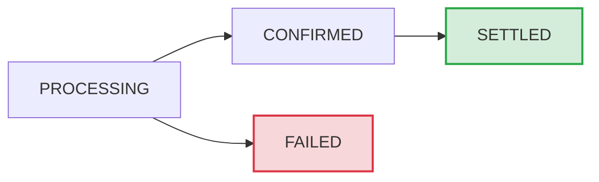

# Payment instruments payins

The payment instrument acts as a pre-authorised source of funds allowing for the funding of transfers via a pull without the owner of the funds being present at the moment of initiation.

## Prerequisites

Before creating a payin, you must:

1. [Create a transfer](/guides/product/send-money) to be funded.
2. Have a [connected payment instrument](/guides/product/send-money/funding/direct-debit/create-payment-instrument) with `status: CONNECTED`.


## Supported schemes

Payins are supported for all payment instrument schemes:

| Scheme | Currency | Region | Status |
|  --- | --- | --- | --- |
| BACS | GBP | United Kingdom | Live |
| SEPA | EUR | Europe | Live |
| ACH | USD | United States | 🟡 **BETA** |
| EFT | CAD | Canada | 🟡 **BETA** |


## Create a new payin 

Creating a payin initiates a payment from a connected payment instrument to fund a transfer.

### Endpoint

```
POST profiles/{profileId}/payment-instruments/{paymentInstrumentId}/payins
```

### Path parameters

| Parameter | Type | Required? | Description |
|  --- | --- | --- | --- |
| `profileId` | integer | Yes | Your personal or business profile ID. |
| `paymentInstrumentId` | uuid | Yes | Connected payment instrument ID. |


### Request body

| Parameter | Type | Required? | Description |
|  --- | --- | --- | --- |
| `payinSessionId` | uuid | Yes | Session ID linking the payin to the transfer being funded. |
| `reference` | string | No | Additional statement reference (displayed alongside payment instrument reference). **Not supported for ACH and EFT. Use `details.reference` in the [transfer request](/api-reference/standard-transfer/transfercreate) instead**. |


## Examples by scheme

### GBP payin (BACS)

Example request
```json
{
  "payinSessionId": "8d63a219-eb86-42c7-a785-02875c281507",
  "reference": "PAY0001"
}
```

Example response
```json
{
  "id": "67136333-0b4d-4f72-49bf-24088f687416",
  "amount": 123.45,
  "currency": "GBP",
  "status": "PROCESSING",
  "paymentInstrumentId": "67133810-d4f6-47b4-a948-09b2d8438b43",
  "payinSessionId": "8d63a219-eb86-42c7-a785-02875c281507",
  "reference": "PAY0001",
  "failureReason": null
}
```

Custom reference constraints
If you are sending custom payment references when creating BACS payments, then check the overall [reference constraints](/guides/product/send-money/funding/direct-debit/mandates-standards#bacs-constraints).

### EUR payin (SEPA)

Example request
```json
{
  "payinSessionId": "9f74b320-fc97-53d8-b896-13986d392618",
  "reference": "PAY0001"
}
```

Example response
```json
{
  "id": "7f8e9d0c-1b2a-3c4d-5e6f-7a8b9c0d1e2f",
  "amount": 250.00,
  "currency": "EUR",
  "status": "PROCESSING",
  "paymentInstrumentId": "c1dca180-2939-461b-913c-d9638e6a93ee",
  "payinSessionId": "9f74b320-fc97-53d8-b896-13986d392618",
  "reference": "PAY0001",
  "failureReason": null
}
```

Custom reference constraints
If you are sending custom payment references when creating SEPA payments, then check the overall [reference constraints](/guides/product/send-money/funding/direct-debit/mandates-standards#sepa-constraints).

### USD payin (ACH)

ACH support is currently in beta.
The API is stable and production-ready, but may change without notice.

Example request
```json
{
  "payinSessionId": "b2c3d4e5-f6a7-4b8c-9d0e-1f2a3b4c5d6e"
}
```

Example response
```json
{
  "id": "89abcdef-1234-5678-90ab-cdef12345678",
  "amount": 500.00,
  "currency": "USD",
  "status": "PROCESSING",
  "paymentInstrumentId": "a1b2c3d4-e5f6-4a7b-8c9d-0e1f2a3b4c5d",
  "payinSessionId": "b2c3d4e5-f6a7-4b8c-9d0e-1f2a3b4c5d6e",
  "reference": null,
  "failureReason": null
}
```

Custom references for ACH payins not supported
We do not support setting custom references for ACH payins currently. However, you can still specify custom references in the `details.reference` field when [creating the transfer](/api-reference/standard-transfer/transfercreate).

### CAD payin (EFT)

EFT support is currently in beta.
The API is stable and production-ready, but may change without notice.

Example request
```json
{
  "payinSessionId": "c3d4e5f6-a7b8-4c9d-0e1f-2a3b4c5d6e7f"
}
```

Example response
```json
{
  "id": "0a1b2c3d-4e5f-6789-0abc-def123456789",
  "amount": 750.00,
  "currency": "CAD",
  "status": "PROCESSING",
  "paymentInstrumentId": "f1e2d3c4-b5a6-4978-8c9d-0e1f2a3b4c5d",
  "payinSessionId": "c3d4e5f6-a7b8-4c9d-0e1f-2a3b4c5d6e7f",
  "reference": null,
  "failureReason": null
}
```

Custom references for EFT payins not supported
We do not support setting custom references for EFT payins currently. However, you can still specify custom references in the `details.reference` field when [creating the transfer](/api-reference/standard-transfer/transfercreate).

## Response schema

All schemas return the same response structure:

| Field | Type | Description |
|  --- | --- | --- |
| `id` | uuid | Unique payin identifier. |
| `amount` | decimal | Payin amount (derived from transfer). |
| `currency` | string | 3-character currency code (`GBP`/`EUR`/`USD`/`CAD`). |
| `status` | string | Current payin status: `PROCESSING`, `CONFIRMED`, `SETTLED`, or `FAILED`. |
| `paymentInstrumentId` | uuid | Source payment instrument. |
| `payinSessionId` | uuid | Associated transfer session. |
| `reference` | string | Statement reference (nullable). |
| `failureReason` | string | Failure reason (null unless `status=FAILED`). |


## Get payin

The get payin request retrieves the details of a specific payin.

Wise also exposes updates to the Payin via the `payment-instruments-payins#status-change` webhook. See the [Webhooks](#webhooks) section below for more details.

### Endpoint

```
GET profiles/{profileId}/payment-instruments/{paymentInstrumentId}/payins/{payinId}
```

### Path parameters

| Parameter | Type | Required? | Description |
|  --- | --- | --- | --- |
| `profileId` | integer | Yes | Your personal or business profile ID. |
| `paymentInstrumentId` | uuid | Yes | The payment instrument ID. |
| `payinId` | uuid | Yes | the payin ID. |


### Response example

```json
{
  "id": "67136333-0b4d-4f72-49bf-24088f687416",
  "amount": 123.45,
  "currency": "GBP",
  "status": "SETTLED",
  "paymentInstrumentId": "67133810-d4f6-47b4-a948-09b2d8438b43",
  "payinSessionId": "8d63a219-eb86-42c7-a785-02875c281507",
  "reference": "PAY0001",
  "failureReason": null
}
```

## List payins

The list payin request retrieves up to 1000 most recent payins for a specific payment instrument. Pagination is not currently supported.

### Endpoint

```
GET profiles/{profileId}/payment-instruments/{paymentInstrumentId}/payins
```

### Path parameters

| Parameter | Type | Required? | Description |
|  --- | --- | --- | --- |
| `profileId` | integer | Yes | Your personal or business profile ID. |
| `paymentInstrumentId` | uuid | Yes | The payment instrument ID. |


### Response example

```json
{
  "payins": [
    {
      "id": "67136333-0b4d-4f72-49bf-24088f687416",
      "amount": 123.45,
      "currency": "GBP",
      "status": "SETTLED",
      "paymentInstrumentId": "67133810-d4f6-47b4-a948-09b2d8438b43",
      "payinSessionId": "8d63a219-eb86-42c7-a785-02875c281507",
      "reference": "PAY0001",
      "failureReason": null
    },
    {
      "id": "78247444-1c5e-5083-5acf-35199f798c527",
      "amount": 456.78,
      "currency": "GBP",
      "status": "FAILED",
      "paymentInstrumentId": "67133810-d4f6-47b4-a948-09b2d8438b43",
      "payinSessionId": "af85c330-fd08-64e9-c907-24097e503729",
      "reference": "PAY0002",
      "failureReason": "REFER_TO_PAYER"
    }
  ]
}
```

## Payin statuses

- `PROCESSING`: Wise is in the process of pulling the funds from the account.
- `CONFIRMED`: The source institution has confirmed that the source instrument has been debited.
- `SETTLED`: The funds are now available for use and will fund the associated transfer.
- `FAILED`: The payment has failed due to cancellation or issues encountered while processing the payment. Refer to `failureReason` for more granular reasoning.


### Status flow



## Handling failed payins 

Payins can fail for various reasons. When this occurs, the `status` is set to `FAILED` and the `failureReason` field provides details.

### Failure reasons

| Reason | Description |
|  --- | --- |
| `REFER_TO_PAYER` | Customer's bank was unable to process the direct debit. |
| `AUTHORISATION_DISPUTED` | Customer disputed authorizing this mandate or specific payin amount. |
| `PAYMENT_INSTRUMENT_DISCONNECTED` | Associated payment instrument is no longer active. |
| `OTHER` | Technical or bank-specific issue. |


### Failed payin example

```json
{
  "id": "78247444-1c5e-5083-5acf-35199f798c527",
  "amount": 456.78,
  "currency": "GBP",
  "status": "FAILED",
  "paymentInstrumentId": "67133810-d4f6-47b4-a948-09b2d8438b43",
  "payinSessionId": "af85c330-fd08-64e9-c907-24097e503729",
  "reference": "PAY0002",
  "failureReason": "REFER_TO_PAYER"
}
```

## Webhooks

Webhooks provide real-time updates on status changes for your payment instruments. Subscribe to these events to avoid constantly polling the API for status changes.

The `payment-instruments-payins#status-change` webhook notifies you when a payin's status changes. For example:

- `PROCESSING` → `SETTLED`: Funds have arrived and you can credit the customer.
- `PROCESSING` → `FAILED`: The payment failed (insufficient funds, payer dispute, etc). You can trigger a retry flow, notify the customer, or update internal records with the specific `failure_reason`.


Processing status payload
When a payin enters the processing state:

```json
{
  "subscription_id": "36f45c7e-e4bf-4342-88fc-ead33500f9b8",
  "event_type": "payment-instruments-payins#status-change",
  "schema_version": "0.0.1",
  "sent_at": "2025-01-19T10:15:23Z",
  "data": {
    "resource": {
      "id": "67136333-0b4d-4f72-49bf-24088f687416",
      "payment_instrument_id": "67133810-d4f6-47b4-a948-09b2d8438b43"
    },
    "from_status": null,
    "to_status": "PROCESSING",
    "occurred_at": "2025-01-19T10:15:22Z"
  }
}
```

Settled status payload
When a payin successfully settles:

```json
{
  "subscription_id": "36f45c7e-e4bf-4342-88fc-ead33500f9b8",
  "event_type": "payment-instruments-payins#status-change",
  "schema_version": "0.0.1",
  "sent_at": "2025-01-22T14:30:46Z",
  "data": {
    "resource": {
      "id": "67136333-0b4d-4f72-49bf-24088f687416",
      "payment_instrument_id": "67133810-d4f6-47b4-a948-09b2d8438b43"
    },
    "from_status": "CONFIRMED",
    "to_status": "SETTLED",
    "occurred_at": "2025-01-22T14:30:45Z"
  }
}
```

Failed status payload
When a payin fails, the `failure_reason` field is included in `data.resource`:

```json
{
  "subscription_id": "36f45c7e-e4bf-4342-88fc-ead33500f9b8",
  "event_type": "payment-instruments-payins#status-change",
  "schema_version": "0.0.1",
  "sent_at": "2025-01-20T16:45:19Z",
  "data": {
    "resource": {
      "id": "78247444-1c5e-5083-5acf-35199f798c527",
      "payment_instrument_id": "67133810-d4f6-47b4-a948-09b2d8438b43",
      "failure_reason": "REFER_TO_PAYER"
    },
    "from_status": "PROCESSING",
    "to_status": "FAILED",
    "occurred_at": "2025-01-20T16:45:18Z"
  }
}
```

### Webhook payload fields

| Field | Type | Description |
|  --- | --- | --- |
| `subscription_id` | uuid | ID of the webhook subscription that triggered the event notification. |
| `event_type` | string | The event that occurred in our system (always `payment-instruments-payins#status-change` for this webhook). |
| `schema_version` | string | Webhook schema version (the notification structure used to model the event). Currently `0.0.1`. |
| `sent_at` | string | ISO 8601 timestamp when webhook was sent. |
| `data` | object | Contains the event type and schema version details specific to this webhook. |
| `data.resource.id` | uuid | Payin identifier. |
| `data.resource.payment_instrument_id` | uuid | Associated payment instrument identifier. |
| `data.resource.failure_reason` | string | Reason for failure (only present when `to_status` is `FAILED`). See [Failure reasons](#failed-handling) for possible values. |
| `data.from_status` | string | Previous status (`PROCESSING`, `CONFIRMED`, or `null` for new payins). |
| `data.to_status` | string | New status (`PROCESSING`, `CONFIRMED`, `SETTLED`, or `FAILED`). |
| `data.occurred_at` | string | ISO 8601 timestamp when the status change occurred. |